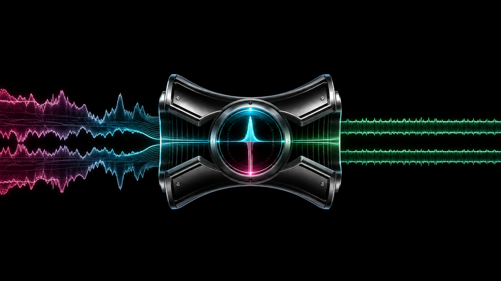
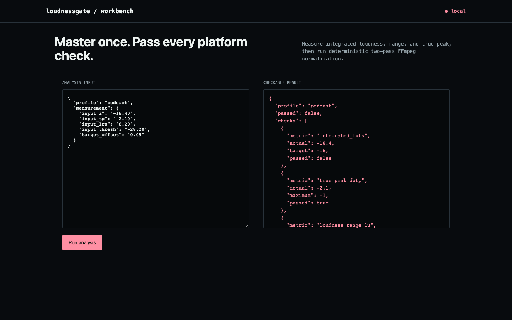

# loudnessgate

**"Sounds about right" is not a loudness spec, and the platform that rejects your upload doesn't care that it sounded fine in your headphones.**



Every major podcast and streaming platform enforces a loudness target under EBU R128 — miss it and your episode either gets auto-normalized in a way you didn't choose, or bounced outright. loudnessgate measures integrated loudness, loudness range, and true peak the same way the spec defines them, tells you exactly which one is failing and by how much, and runs the actual two-pass FFmpeg normalization to fix it instead of a rough single-pass guess.



## How it works

Run FFmpeg's `loudnorm` filter in measurement mode to get the file's real integrated loudness, range, and true peak, compare each against the target profile's limits, and report the gap on every metric independently — a file can be correctly loud but still fail on peak or range. To fix it, feed the first pass's measured values back into a second `loudnorm` pass, which is what makes the correction a calculated gain rather than a blind "add some dB and hope."

## What ships

- Three-metric measurement (integrated loudness, loudness range, true peak) against named delivery profiles (podcast, broadcast, streaming)
- Real two-pass FFmpeg loudnorm normalization, not a single-pass approximation
- Per-metric pass/fail reporting, so you know exactly what's wrong before you fix anything
- CLI, JSON API, browser workbench, Docker, tests, and CI

## Run it end to end

```bash
python -m venv .venv && source .venv/bin/activate
python -m pip install -e .
loudnessgate demo
loudnessgate normalize input.wav mastered.wav --profile podcast
loudnessgate serve
```

Open <http://127.0.0.1:8090>. Analyze your own JSON input with `loudnessgate analyze input.json`.

## API

- `GET /api/demo` returns the committed fixture and result.
- `POST /api/analyze` runs the same engine on a JSON body.

## The result

The podcast fixture measures -18.4 LUFS against a -16 target — 2.4 dB quiet — while its loudness range and true peak already sit comfortably inside spec. loudnessgate reports the exact gain needed and, in the integration test, actually applies real two-pass FFmpeg normalization and remeasures the output to confirm it landed.

## Scope

Broadcast, podcast, and streaming presets here are reasonable engineering defaults, not a guarantee that matches every distributor's current contract. Check the actual target, channel layout, codec, and true-peak requirement for wherever the file is actually going.

## Test

```bash
python -m unittest discover -s tests -v
```

## Research basis

- [EBU R128](https://tech.ebu.ch/loudness/)
- [FFmpeg loudnorm](https://www.ffmpeg.org/ffmpeg-filters.html#loudnorm)

MIT licensed.
